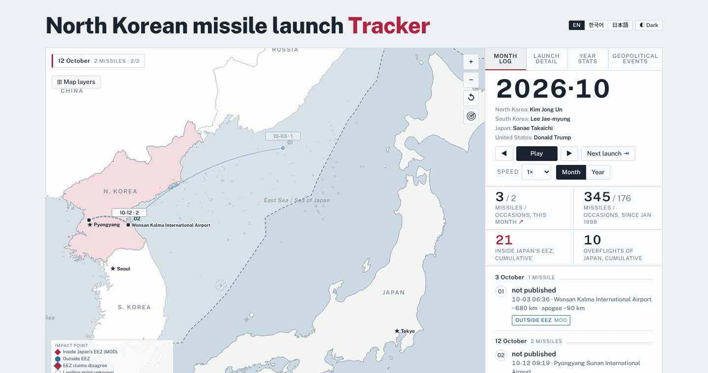

# North Korean Missile Launch Tracker

An interactive map + timeline of North Korean missile launches since 1998, built as a single self-contained HTML page (D3.js v7). Light/dark mode and English / Korean(한국어) / Japanese(日本語) interface switching are built in.

**▶ Live site:** `https://tankboy1212.github.io/northkorean-missile-tracker/` 



## What it shows

- A map of the East Sea / Sea of Japan with reconstructed launch trajectories, Exclusive Economic Zone boundaries (Japan, South Korea, North Korea, China, Russia), optional range rings from Pyongyang, major ports, shipping lanes and military sites.
- A month-by-month ledger: missiles fired, launch occasions, landing verdicts (inside/outside Japan's EEZ, or unpublished).
- A zoomable timeline (1998–present) with party-colored leader bands for North Korea, South Korea, Japan, the US and China.
- A filterable data table of every known launch, with a "regime" filter across all five countries' leaders.
- A separate "Geopolitical events" tab giving dated context — nuclear tests, UN resolutions, inter-Korean events, US/Japan/Russia-related developments — each linked to its original source.

## Why two totals don't match

Japan's Ministry of Defense (MOD) counts launches it detected and chose to announce. The CNS North Korea Missile Test Database counts every known missile meeting a lower threshold (≥300 km range, ≥500 kg payload), using US, South Korean and Japanese reporting. This page uses the CNS record as its backbone — one row per missile — and separately links each MOD statement it can confidently tie to a specific missile. Both totals are shown; neither is "corrected" to match the other.

## Running it

It's one file. Open `index.html` in a browser, or serve the folder with anything static:

```bash
python3 -m http.server 8000
# then open http://localhost:8000
```

No build step. The page loads D3 and its fonts from CDNs (cdnjs, Google Fonts) at runtime, so it needs network access to render fully offline-styled; everything else (data, map geometry, translations) is inlined in the page.

### Publishing with GitHub Pages

1. Push this repo to GitHub.
2. Repo **Settings → Pages → Build and deployment → Source**: "Deploy from a branch".
3. Branch: `main`, folder: `/ (root)`. Save.
4. The site will be live at `https://<your-username>.github.io/<repo-name>/` within a minute or two.

## Data sources and licensing

Full citations and licence terms for every source are printed on the page itself, under **Sources and licences**, and apply per-source (several of these sources set terms that are *not* MIT and are not satisfied by this repository's own licence):

- **CNS North Korea Missile Test Database** (James Martin Center for Nonproliferation Studies, for the Nuclear Threat Initiative) — no stated reuse licence. Shown here with credit; **not redistributed as a file**, which is why the in-page CSV export is disabled.
- **[nagix/nk-missile-tests](https://github.com/nagix/nk-missile-tests)** © Akihiko Kusanagi — Apache License 2.0. Supplies the structured copy of the CNS records and MOD-linked bearings this page builds on.
- **Japanese Ministry of Defense** press statements and white papers — used under Japan's Government Standard Terms of Use (政府標準利用規約 第2.0版), stated by the ministry to be CC BY 4.0-compatible.
- **Flanders Marine Institute**, *EEZ_land_union_v4* — CC BY 4.0, via [lsdch/countries-boundaries](https://github.com/lsdch/countries-boundaries) (GPL-3.0; that licence covers the conversion scripts, not the Marine Regions data itself).
- **Natural Earth** (public domain) via [topojson/world-atlas](https://github.com/topojson/world-atlas) (ISC).
- **D3.js** 7.9.0 and **TopoJSON Client** 3.1.0 — ISC License, © Mike Bostock / Michael Bostock.
- Geopolitical-context entries link out to their original publishers (UN, CTBTO, IOC, national governments, state news agencies) rather than reproducing their text.

This repository's own code (the HTML/CSS/JS written for this page) is released under the [MIT License](LICENSE). That license does **not** extend to the datasets above — see each one's terms before reusing it elsewhere.

## Known limitations

- Landing points without an official figure are reconstructed estimates (great-circle projection from launch site, published bearing and range), shown with an error ellipse — not measurements.
- "Military sites" are shown at city level only, from published open sources, as general context — not a claim about any individual launch.
- The CSV export control is intentionally disabled (see licensing note above).

## Acknowledgement

This page was inspired by a video shared on X in 2026 that tallied Japanese Ministry of Defense announcements of North Korean missile launches. The idea — showing those launches as a map that moves through time — came from that post; the dataset, launch-by-launch reconstruction, EEZ-verdict linkage, context timeline, wording and all code here were built independently of it, and the totals deliberately differ because a different underlying source is being counted.

## Contributing

Issues and pull requests are welcome — corrections to a launch record, a translation fix, a missing source link, or a UI bug report are all useful. Please link a source for any factual correction.
